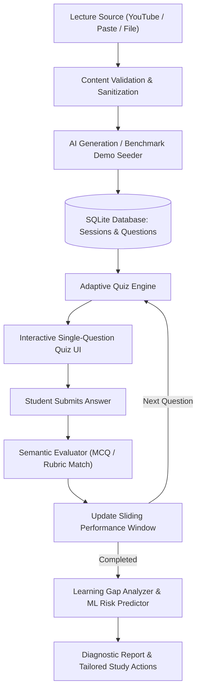

# AI LearnMate — Watch. Learn. Test. Improve.

[](#sdg-alignment)
[](#technology-stack)
[-16a34a.svg)](#testing)

An AI-powered formative assessment and adaptive learning-gap detection web application for students. AI LearnMate transforms lecture notes, transcripts, or video captions into dynamic diagnostic quizzes, Pinpoints conceptual misconceptions, and provides personalized study recommendations.

---

## Table of Contents
1. [Project Overview](#project-overview)
2. [Problem Statement](#problem-statement)
3. [Proposed Solution](#proposed-solution)
4. [UN SDG Alignment](#sdg-alignment)
5. [Key Features](#key-features)
6. [Architecture & Data Flow](#architecture--data-flow)
7. [Technology Stack](#technology-stack)
8. [Folder Structure](#folder-structure)
9. [Database Schema](#database-schema)
10. [Setup Instructions for Windows](#setup-instructions-for-windows)
11. [Running the Application](#running-the-application)
12. [Testing](#testing)
13. [Demo Mode (Zero-API Offline Hackathon Defense)](#demo-mode)
14. [Adaptive Engine & Explainable Rules](#adaptive-engine--explainable-rules)
15. [Limitations & Future Scope](#limitations--future-scope)

---

## Project Overview
* **Tagline:** Watch. Learn. Test. Improve.
* **Category:** AI & Machine Learning in Education
* **Target Audience:** Engineering & College Students (B.Tech CSE benchmarked)

When students watch educational videos or read lecture slides, they often experience an **illusion of competence**—mistaking passive familiarity for true conceptual mastery. **AI LearnMate** solves this by actively testing comprehension through adaptive questioning immediately after lecture consumption.

---

## Problem Statement
Traditional university assessments suffer from three major shortcomings:
1. **Delayed Feedback Loop:** Midterm exams take place weeks after lectures, when it is too late to diagnose early misconceptions.
2. **One-Size-Fits-All Testing:** Static quizzes fail to adapt to individual student ability, boring strong students while discouraging struggling learners.
3. **Black-Box AI Evaluation:** Generic AI tools summarize videos or generate repetitive questions without structured gap analysis, honest evidence tracking, or syllabus coverage.

---

## Proposed Solution
AI LearnMate provides an end-to-end formative assessment pipeline:
* **Multi-Source Intake:** Ingests lecture notes, YouTube captions, or uploaded plain text files.
* **Source-Grounded AI Question Generation:** Extracts core topics and generates balanced Multiple Choice (MCQ) and Short-Answer questions strictly bounded by the lecture text.
* **Explainable Adaptive Engine:** Adjusts difficulty (`Easy` ↔ `Medium` ↔ `Hard`) dynamically using a sliding performance window and topic balancing rules.
* **Semantic Short-Answer Evaluation:** Evaluates student explanations against conceptual rubrics, accepting equivalent phrasing and synonyms rather than demanding rigid keyword matching.
* **Honest Gap Analytics:** Categorizes topic mastery (`Strong`, `Developing`, `Needs Revision`), while explicitly flagging topics with only 1 question as `Limited Evidence` to prevent overconfidence.
* **Concrete Remediation:** Translates mistakes into actionable study steps and targeted practice tasks.

---

## SDG Alignment
### United Nations SDG 4: Quality Education
* **Target 4.4:** Substantially increase the number of youth and adults with relevant technical and vocational skills.
* **Equity in Learning:** Provides individualized diagnostic assessment to students regardless of whether their institution can afford dedicated 1-on-1 tutoring.
* **Bilingual Inclusivity:** Supports English and conversational Hindi/Hinglish to bridge linguistic barriers for vernacular medium engineering students.

---

## Key Features

1. **Multiple Input Methods**
   - Direct text paste (notes, summaries, transcripts).
   - YouTube video link caption extraction (via `youtube-transcript-api` with transparent fallback).
   - Text file upload (`.txt`, `.md`, `.vtt`, `.srt`) capped at 2MB.

2. **Adaptive Single-Question Delivery**
   - Questions presented one-at-a-time.
   - Answers concealed until submission.
   - Real-time feedback with rubric breakdown and explanation.

3. **Bilingual Assessment (English & Hinglish)**
   - Technical terms retained in Roman English while explanations adapt to conversational Hindi/Hinglish.

4. **Transparent Machine Learning Component**
   - Logistic Regression risk model evaluating student feature telemetry (`recent_accuracy`, `topic_accuracy`, `attempts`, `difficulty`) to forecast remediation risk.

5. **Diagnostic Learning Report**
   - Visual mastery progress bars.
   - Misconception pattern cards extracted from wrong answers.
   - Prioritized study recommendations.
   - Targeted follow-up revision tasks.

6. **Historical Audit & Progress Tracking**
   - Full question-by-question review of all attempts.
   - Persistent SQLite history tracking scores, topics, and completion status.

---

## Architecture & Data Flow



---

## Technology Stack

| Layer | Technology | Rationale |
|---|---|---|
| **Backend** | Python 3, Flask | Minimalist, highly explainable, lightweight WSGI framework. |
| **Database** | SQLite3 (`sqlite3` standard library) | Serverless, zero-configuration, ACID-compliant relational DB. |
| **Frontend** | HTML5, Custom CSS3, Vanilla JavaScript | No bloated node_modules or CDN dependencies; fast and responsive. |
| **Templating** | Jinja2 | Clean server-side HTML rendering with template inheritance. |
| **AI Integration** | Google Gemini API (REST) / OpenAI Fallback | High-speed structured JSON question generation and rubric evaluation. |
| **Machine Learning** | Pure Python / NumPy Logistic Regression | Explainable model calculating risk probabilities from student telemetry. |
| **Video Ingestion** | `youtube-transcript-api` | Official caption retrieval with graceful failure handling. |

---

## Folder Structure

```
ai_learnmate/
│
├── app.py                   # Main Flask application and REST routes
├── config.py                # Central environment and limit configuration
├── database.py              # SQLite schema, parameterized queries, and CRUD
├── ai_service.py            # AI prompt generation, JSON validation & rubric evaluator
├── youtube_service.py       # YouTube caption extraction with fallback
├── quiz_engine.py           # Explainable rule-based adaptive engine & ML model
├── learning_analyzer.py     # Topic mastery calculations and gap diagnostics
├── demo_data.py             # Pre-curated B.Tech Operating Systems benchmark questions
│
├── requirements.txt         # Project dependencies
├── .env.example             # Template for API keys and configuration
├── .gitignore               # Excludes secrets, databases, and caches
├── README.md                # Comprehensive documentation
├── VIVA_QUESTIONS.md        # 22 viva & presentation defense questions
│
├── templates/               # Jinja2 HTML templates
│   ├── base.html            # Master layout with navbar, alerts, and SDG 4 footer
│   ├── index.html           # Landing page with problem statement & steps
│   ├── create_session.html  # Session creation form (YouTube, paste, file upload)
│   ├── quiz.html            # Interactive single-question assessment screen
│   ├── report.html          # Detailed learning diagnostic report
│   ├── history.html         # Past assessment attempts & progress trends
│   ├── review.html          # Question-by-question review with rubrics
│   └── error.html           # Friendly user error recovery screen
│
├── static/
│   ├── css/
│   │   └── style.css        # Professional Navy & Teal responsive design
│   └── js/
│       └── app.js           # Vanilla JS for async answer evaluation & UI tabs
│
└── tests/                   # Automated unit & integration tests
    ├── __init__.py
    ├── test_database.py
    ├── test_quiz_engine.py
    ├── test_learning_analyzer.py
    ├── test_ai_and_youtube.py
    └── test_routes.py
```

---

## Database Schema

```sql
-- 1. Learning Sessions
CREATE TABLE learning_sessions (
    id INTEGER PRIMARY KEY AUTOINCREMENT,
    session_uuid TEXT UNIQUE NOT NULL,
    title TEXT NOT NULL,
    subject TEXT NOT NULL,
    source_type TEXT NOT NULL,       -- 'paste', 'youtube', 'file', 'demo'
    source_content TEXT NOT NULL,
    language TEXT NOT NULL DEFAULT 'en',
    target_questions INTEGER NOT NULL DEFAULT 10,
    is_demo INTEGER NOT NULL DEFAULT 0,
    created_at TIMESTAMP DEFAULT CURRENT_TIMESTAMP,
    status TEXT NOT NULL DEFAULT 'created'
);

-- 2. Quiz Questions
CREATE TABLE quiz_questions (
    id INTEGER PRIMARY KEY AUTOINCREMENT,
    session_id INTEGER NOT NULL,
    question_text TEXT NOT NULL,
    question_type TEXT NOT NULL,      -- 'mcq' or 'short_answer'
    options_json TEXT,               -- JSON array for MCQs
    correct_answer TEXT NOT NULL,
    explanation TEXT NOT NULL,
    topic TEXT NOT NULL,
    difficulty TEXT NOT NULL,         -- 'Easy', 'Medium', 'Hard'
    evaluation_rubric TEXT,
    order_index INTEGER DEFAULT 0,
    FOREIGN KEY (session_id) REFERENCES learning_sessions(id) ON DELETE CASCADE
);

-- 3. Quiz Attempts
CREATE TABLE quiz_attempts (
    id INTEGER PRIMARY KEY AUTOINCREMENT,
    attempt_uuid TEXT UNIQUE NOT NULL,
    session_id INTEGER NOT NULL,
    current_question_index INTEGER DEFAULT 0,
    total_questions_planned INTEGER NOT NULL,
    score REAL DEFAULT 0.0,
    total_answered INTEGER DEFAULT 0,
    total_correct INTEGER DEFAULT 0,
    current_difficulty TEXT DEFAULT 'Medium',
    is_completed INTEGER DEFAULT 0,
    started_at TIMESTAMP DEFAULT CURRENT_TIMESTAMP,
    completed_at TIMESTAMP,
    FOREIGN KEY (session_id) REFERENCES learning_sessions(id) ON DELETE CASCADE
);

-- 4. Student Answers
CREATE TABLE student_answers (
    id INTEGER PRIMARY KEY AUTOINCREMENT,
    attempt_id INTEGER NOT NULL,
    question_id INTEGER NOT NULL,
    student_answer TEXT NOT NULL,
    is_correct INTEGER NOT NULL,      -- 1 = Correct, 0 = Incorrect
    score_awarded REAL DEFAULT 0.0,
    evaluation_feedback TEXT NOT NULL,
    answered_difficulty TEXT NOT NULL,
    topic TEXT NOT NULL,
    created_at TIMESTAMP DEFAULT CURRENT_TIMESTAMP,
    FOREIGN KEY (attempt_id) REFERENCES quiz_attempts(id) ON DELETE CASCADE,
    FOREIGN KEY (question_id) REFERENCES quiz_questions(id) ON DELETE CASCADE
);

-- 5. Topic Performance
CREATE TABLE topic_performance (
    id INTEGER PRIMARY KEY AUTOINCREMENT,
    attempt_id INTEGER NOT NULL,
    topic TEXT NOT NULL,
    questions_attempted INTEGER DEFAULT 0,
    questions_correct INTEGER DEFAULT 0,
    accuracy_percentage REAL DEFAULT 0.0,
    mastery_level TEXT NOT NULL,      -- 'Strong', 'Developing', 'Needs revision', 'Limited Evidence'
    needs_revision INTEGER DEFAULT 0,
    misconceptions_identified TEXT,   -- JSON array of error patterns
    FOREIGN KEY (attempt_id) REFERENCES quiz_attempts(id) ON DELETE CASCADE
);
```

---

## Setup Instructions for Windows

### Step 1: Open PowerShell or Command Prompt
Navigate to the project folder:
```powershell
cd C:\Users\HP\.gemini\antigravity\scratch\ai_learnmate
```

### Step 2: Create and Activate a Virtual Environment
```powershell
python -m venv venv
.\venv\Scripts\Activate.ps1
```
*(If script execution is disabled on your system, run `Set-ExecutionPolicy -Scope CurrentUser -ExecutionPolicy RemoteSigned` once in PowerShell).*

### Step 3: Install Required Dependencies
```powershell
pip install -r requirements.txt
```

### Step 4: Configure Environment Variables
Copy the `.env.example` file to `.env`:
```powershell
copy .env.example .env
```
Open `.env` in any text editor and optionally add your **Google Gemini API Key**:
```ini
GEMINI_API_KEY=your_actual_gemini_api_key_here
```
> *Note: If you do not have an API key, you can run the application directly in **Demo Mode** without an internet connection!*

---

## Running the Application

Start the Flask development server:
```powershell
python app.py
```

Open your web browser and navigate to:
```
http://127.0.0.1:5000
```

---

## Testing

The project includes an automated test suite with **23 unit and integration tests** verifying all business logic without depending on external network calls.

Run all tests:
```powershell
python -m unittest discover -s tests -v
```

### Test Coverage Highlights:
* `test_database.py`: Session lifecycle, question persistence, foreign key cascading, and student response logging.
* `test_quiz_engine.py`: Baseline starting difficulty, upward step to Hard on high accuracy, downward step to Easy on failure, and question uniqueness.
* `test_learning_analyzer.py`: Honest evidence threshold (1-question topics marked as `Limited Evidence`), accurate accuracy computations, and recommendation generation.
* `test_ai_and_youtube.py`: YouTube URL extraction, caption fallback, JSON parser robustness, and conceptual short-answer evaluation with synonyms.
* `test_routes.py`: End-to-end Flask client workflow from session creation to quiz submission, reporting, and history review.

---

## Demo Mode
**Zero-API Offline Hackathon Defense**

During a live college hackathon, WiFi connections frequently drop and AI rate limits can be reached. AI LearnMate includes a dedicated **Demo Mode**:
1. Click **"Launch Demo Assessment"** on the Create Session page or Landing Page.
2. AI LearnMate loads a curated B.Tech Operating Systems benchmark lecture covering:
   - *Process Synchronization & Race Conditions*
   - *Critical Section Problem (Mutual Exclusion, Progress, Bounded Waiting)*
   - *Semaphores (wait/signal operations)*
   - *Producer-Consumer Bounded-Buffer Problem*
   - *Deadlocks & Priority Inversion*
3. Generates 10 pre-verified questions (Easy, Medium, Hard, MCQ, and Short Answer) in English or Hindi/Hinglish.
4. Operates 100% offline with full adaptive transitions, short-answer evaluations, and gap analysis.
5. Visibly displays a **"Demo Assessment Active"** badge to ensure academic transparency.

---

## Adaptive Engine & Explainable Rules

The adaptive question engine is deterministic and fully explainable:

1. **Starting Point:** New learners start with a `Medium` baseline question to assess ability.
2. **Recent Window (Size = 3):**
   - **Step Up (Medium → Hard or Easy → Medium):** Triggered when learner achieves $\ge 70\%$ accuracy over the last 2 to 3 questions.
   - **Step Down (Hard → Medium or Medium → Easy):** Triggered when learner drops to $\le 35\%$ accuracy over the recent window.
3. **Concept Remediation Rule:** If a student answers incorrectly on topic $T$, the engine immediately looks for an `Easy` or simpler question on topic $T$ to rebuild foundational understanding before advancing.
4. **Syllabus Coverage Balancing:** Questions are selected from the least-tested topics to guarantee that every major lecture concept is evaluated.
5. **No Repeats:** Questions already answered in the active attempt are strictly excluded.

---

## Limitations & Future Scope

### Current Limitations:
1. **Automated Captions:** YouTube extraction depends on the video creator having enabled public captions or subtitles.
2. **Short Quizzes:** In a 5-question quiz, certain sub-topics may only have 1 question; these are honestly flagged as `Limited Evidence`.
3. **Context Window:** Extremely long transcripts (>40,000 characters) are truncated to fit model token boundaries.

### Future Scope:
1. **Audio Transcription:** Integrate local Whisper model for direct MP3/WAV lecture audio transcription.
2. **Spaced Repetition Scheduler:** Automatically notify students 3 days later to re-test topics that were marked `Needs Revision`.
3. **College LMS Integration:** Export student gap reports to Moodle and Google Classroom via LTI protocols.
